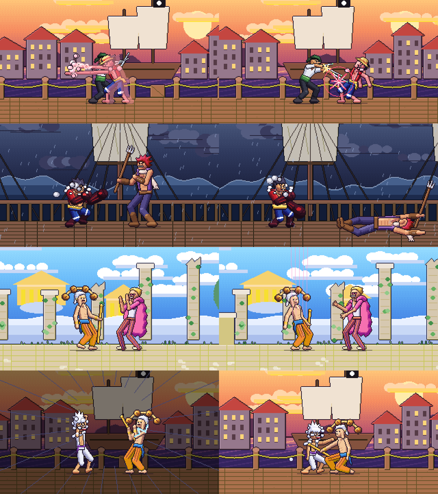

# One Piece – 2D Pixel Fighter (Roblox)

A 1v1 arcade fighting game for Roblox, drawn entirely in 2D pixel art. It has seven fighters, a Street Fighter–style combat system, best-of-three rounds and server-authoritative online play.

This is a separate project from the browser game in the repository root.

| | |
|---|---|
| **Fighters** | Luffy Gear 2 · Luffy Gear 4 · Luffy Gear 5 · Doflamingo · Enel · Zoro · Katakuri |
| **Modes** | Online 1v1 · Training · Local Test Match (vs CPU or 2 players on one device) · Character Select (inspect) |
| **Stages** | Pirate Harbour (dusk) · Storm Deck (rain + lightning) · Sky Island Ruins |
| **Input** | Keyboard, two gamepads, touch |
| **Screen** | 320×180 virtual pixels, integer-scaled (×4 at 720p, ×6 at 1080p), nearest-neighbour |



*Frames rendered offline by the game's own Luau renderer during CPU matches. The HUD is Roblox GUI and isn't part of these captures.*

---

## Opening it in Roblox Studio

**Option A – the prebuilt place (quickest)**

1. Open `build/OnePiecePixelFighter.rbxl` in Roblox Studio.
2. Press **Play**. You should land on the title screen with a CPU match playing behind it.
3. To test online, use **Test → Clients and Servers → 2 players**, then pick **ONLINE 1V1** in both windows.

**Option B – live sync with Rojo** (recommended for development)

```bash
rojo serve default.project.json
```

Then connect from the Rojo plugin in Studio. To rebuild the place file yourself:

```bash
rojo build default.project.json -o build/OnePiecePixelFighter.rbxl
```

**Before publishing**, set **Players per server** to an even number (for example 8). Every pair in the queue gets its own match.

**Renderer backends.** The game picks its renderer automatically. Nothing needs configuring:

- **EditableImage** (pixel-perfect, fastest) is used when Roblox allows it. That means Studio play-tests, or published games whose owner is **13+ and ID-verified** and has turned on **File → Game Settings → Security → Allow Mesh & Image APIs**. That Security option only appears after the game has been published.
- **GUI frames** are used everywhere else. The fallback draws the same pixel art with ordinary Roblox Frames: sprites as merged same-colour rectangles, stages built once and scrolled. It needs no settings or verification. The only visual difference is that dash and super afterimages are skipped.

To test the fallback in Studio, set `Canvas.ForceGui = true` in `StarterPlayerScripts/Render/Canvas.luau`.

---

## Controls

| Action | Keyboard (P1) | Keyboard (P2, local only) | Gamepad | Touch |
|---|---|---|---|---|
| Move | A / D | ← / → | Left stick / D-pad | D-pad |
| Jump | W | ↑ | A or up | JMP / up |
| Crouch | S | ↓ | Down | Down |
| Dash | Space, or double-tap a direction | Right Ctrl | R3, or double-tap | DASH, or double-tap |
| Light | J | N (Num 1) | X | L |
| Medium | K | M (Num 2) | Y | M |
| Heavy | L | , (Num 3) | RB | H |
| Special | U | . (Num 4) | B | SP |
| Super (full meter) | I | / (Num 5) | RT | SU |
| Block | Left Shift | Right Shift (Num 0) | LB / LT | BLK |
| Pause (local modes) | P | – | Start | – |
| Training: hitboxes / dummy / reset | H / T / R | | | panel buttons |

**Command variants:**

- Down + Special is **Mantra Step** for Enel and **Mochi Flurry** for Katakuri.
- Holding Special charges **Gear 4's Kong Gun**.
- Special with 25+ meter is **Gear 5's EX Toon Bounce**.
- Gear 5 can double jump.

**Blocking:** hold Block to stand-guard and Block + Down to crouch-guard. Lows must be crouch-blocked; overheads (all jump attacks and Gear 4's Kong Hammer) must be stand-blocked.

---

## How the combat works

Everything below lives in `src/ReplicatedStorage/Shared/Sim`. It is pure Luau with no Roblox APIs, so the server, the client and the offline tests all run the same code.

- **60 Hz frame-based simulation.** Every move has startup / active / recovery frames, damage, chip, hitstun, blockstun, hitstop, knockback, launch or knockdown, and a height (mid/low/overhead). Specials and supers can add projectiles, multi-hits, scripted movement, armor, invulnerability, counters, charge or a teleport. Moves are defined in each `Characters/<Id>/CharacterConfig.luau`; defaults and validation are in `Shared/AttackDefinitions.luau`.
- **Hitboxes follow the art.** Hitboxes are generated from the striking limb, blade, staff or trident of the drawn frame. They exist only on active frames, and the animation is time-mapped so the strike pose is on screen exactly then. Zoro's blade boxes follow the sword segment frame by frame, so a sword only damages through its real active hitbox.
- **One hit per hit window.** A hit registry per move (or per multi-hit slot) prevents double hits. Trades resolve simultaneously.
- **Combos:**
  - Chains go L → L → M → H → Special → Super, but only after the move connects (hit or block) and inside its cancel window.
  - The same normal cannot be chained into itself.
  - Damage scales down after the 3rd hit (to a minimum of 30%), with an extra penalty when the same move repeats.
  - Hitstun decays in long combos, and a juggle limit makes the defender invulnerable after 4 air hits.
  - The input buffer runs on a per-fighter clock that pauses during hitstop, so links feel right.
- **Meter and supers.** Meter fills from hits, blocks, damage taken and specials. A super costs 100 and triggers a super freeze. Gear 5 gains meter 35% faster.
- **Counter hits.** Hitting a move during its startup deals +20% damage and extra hitstun, and shows COUNTER!
- **Rounds and match flow.** Rounds open with ROUND N / FINAL ROUND, character intros and FIGHT!. The 99 s timer is configurable in `CombatConfig.RoundTime`. A KO plays in slow motion, a time-out gives the round to whoever has more health, PERFECT is shown when earned, and first to 2 rounds wins. The results screen offers rematch, character select or main menu.

| Fighter | Identity | Signature mechanics |
|---|---|---|
| Gear 2 | Rushdown | Fastest walk/dash, 4-frame jab, Jet Gatling (6 hits), Jet Rush super |
| Gear 4 | Powerhouse | Long Kong punches, overhead Kong Hammer, **chargeable** Kong Gun with armor, King Kong Gun super, bounce-jump |
| Gear 5 | Trickster | Double jump, floaty gravity, rubber reach, giant sweep, **EX** Toon Bounce (meter for armor + damage), Giant Fist super |
| Doflamingo | Control | Long string normals, low floor string, **Parasite** binds the opponent in place, **Birdcage** covers a huge area |
| Enel | Zoner | Vari lightning bolt, Mantra Step teleport, Kari burst, **El Thor** pillar drops on the opponent's position |
| Zoro | Swordsman | Blade-accurate hitboxes, 2-hit cross slash, advancing Oni Giri, 36 Pound Cannon projectile, Asura nine-sword super |
| Katakuri | Counter | Longest reach (mochi arm, Mogura), mochi spike from the floor, **Future Sight** counter stance, Mochi Flurry, Power Mochi super |

---

## Online 1v1

The **server owns the match.** Clients only send button state, as held bits plus presses since the last send, with a sequence number. The server runs the shared simulation at 60 Hz and computes all hits, damage, meter, rounds and results. It streams compact binary snapshots (about 100–200 bytes, 30 Hz) over an `UnreliableRemoteEvent`, and combat events over a reliable `RemoteEvent`. Clients interpolate the snapshots.

The server validates every input message:

- argument types, rejecting NaN and non-numbers
- strictly increasing sequence numbers, so duplicates and old packets are dropped
- a per-player rate limit (90 messages/s)
- sanitised bits, so impossible combinations like left+right are removed
- a 0.6 s timeout that releases held buttons when a client goes quiet

Leaving or disconnecting mid-match is a forfeit. A rematch starts only when both players accept.

Online play is server-authoritative with interpolation, not rollback. Your own inputs show up after your round-trip time plus about 50 ms of interpolation. Training and Local Test Match run the simulation on your device with no added delay.

---

## Project structure

```
default.project.json            Rojo project
build/OnePiecePixelFighter.rbxl ready-to-open place
src/
  ReplicatedStorage/
    Shared/
      CombatConfig.luau         every tuning value (screen, rounds, physics, scaling, anti-exploit)
      CharacterData.luau        roster registry - add a fighter by adding a folder + listing it
      AttackDefinitions.luau    move schema, strength-class defaults, validation, frame advantage
      Protocol.luau             View (what the renderer/HUD read) + binary snapshot codec
      Codec.luau                base64 + LZ4 decoders for sprite/stage data
      Sim/  Match Fighter Damage Hitbox Timeline Input AI
    Characters/<Id>/            CharacterConfig, FrameData, Sprites   (see docs/ASSET_INVENTORY.md)
    Stages/                     Harbour, Storm, SkyIsland (palette-indexed parallax layers)
  ServerScriptService/
    Main.server.luau            no avatars, creates Remotes
    Services/ MatchService CombatService RoundService CharacterService
  StarterPlayer/StarterPlayerScripts/
    Main.client.luau  App.luau
    Controllers/ InputController CameraController AudioController
    Sessions/    LocalSession (training / local) OnlineSession (server snapshots)
    Render/      Canvas (EditableImage) Raster (software rasteriser) Renderer Stage Effects SpriteLibrary
    UI/          MainMenu CharacterSelect FightingHUD ResultsScreen TrainingPanel PauseMenu MobileControls Widgets
tools/spritegen/                pixel-art rig + build/import scripts (Python 3, numpy, Pillow)
tests/                          Lune test suite
art/                            generated PNG sheets, previews, stage previews
```

Mapping to the brief's suggested structure:

- **HitboxService and DamageService** are the shared `Sim/Hitbox` and `Sim/Damage` modules. They run on the server for online play, and having one implementation is what makes the client and server agree.
- **CombatRemote, MatchRemote and InputRemote** exist as named in the brief, plus `StateRemote` for snapshots. The server creates all four under `ReplicatedStorage/Remotes`.
- **The GUI** is built from modules in `StarterPlayerScripts/UI` instead of prebuilt `StarterGui` objects. Every element is sized relative to the pixel canvas.

### Rendering

There is one `ImageLabel` with `ResampleMode = Pixelated`, showing a 320×180 `EditableImage`. Each frame, `Raster.luau` composes:

1. a dithered gradient sky
2. parallax layers (copied as opaque spans)
3. drop shadows
4. palette-indexed fighter sprites (mirrored by facing, alternate palette in mirror matches, white-silhouette hit flash with a red outline)
5. projectiles and VFX: sparks, rings, dust and smoke puffs, steam and cloud auras, lightning, threads, sword trails from the real blade tips, afterimages, mochi spikes
6. weather, super-freeze darkening with speed lines, and screen shake

The finished buffer is uploaded with `WritePixelsBuffer`.

The HUD is ordinary GUI layered on the canvas: portraits, health bars with a red damage trail, round markers, timer, super meters, combo counter with damage, banners and super call-outs.

Offline, the renderer costs about 2.5–4.5 ms per frame. On a slow device the client automatically draws at 30 Hz while the simulation keeps 60 Hz.

---

## Changing art, adding fighters

- **Repaint sprites:** edit `art/Characters/<Id>/<Sheet>.png`. Keep the feet on the origin given in the `.json`. Then run:

  ```bash
  python3 tools/spritegen/import_sheet.py <Id> [Sheet]
  ```

  Frame order is preserved, so timing and hitboxes stay valid. New colours are added to the palette. Re-running the import on unedited sheets reproduces identical pixels.
- **Change poses, timing or hitboxes:** edit `tools/spritegen/animsets.py` (or the costume in `chars/*.py`), then run:

  ```bash
  python3 tools/spritegen/build.py <Id>
  ```

- **Rebalance a move:** edit its line in `CharacterConfig.luau`. The animation re-times itself to the new frame data.
- **Add a fighter:** add a costume plus animation set in the tool and a `Characters/<NewId>/CharacterConfig.luau`, then add the id to `CharacterData.Order` and `roster.py`. The engine needs no changes.
- **Stages:** `python3 tools/spritegen/stagegen.py`. Sound IDs are in `Controllers/AudioController.luau`; they default to sounds that ship with Roblox.

---

## Testing

```bash
lune run tests/run.luau          # 41 tests
```

```bash
lune run tests/run_gui.luau      # the same client run with EditableImage unavailable (GUI fallback, ~8 min)
```

```bash
lune run tests/place_check.luau  # inspects the built .rbxl
```

```bash
lune run tests/render_shots.luau 2 && python3 tools/rgba2png.py "tests/out/shot_2_*.rgba" out.png
```

The last command renders real frames through the game's Luau renderer and saves them as a PNG.

What the suite covers:

- **Combat:** all seven slots load with full animation sets and their own assets. Strike poses show exactly during active frames, and every normal of every fighter first hits on an active frame and never outside it. It also covers no double hits, multi-hit caps, blocking by height (mid, low, overhead), chip rules, and L→M→H chains for all fighters. The same normal can't chain into itself, and nothing starts during recovery. Damage scaling, juggle limit, round flow, time-over, best-of-three, projectiles and clashes are tested. So are every special (Parasite bind, Future Sight counter, Mantra Step, Kong Gun charge, Gear 5 EX) and every super connecting. Facing after cross-ups, dash/double jump, stage and camera bounds, and input sanitising complete the list.
- **Integration:** CPU-vs-CPU best-of-three matches for every fighter, plus 28,000 frames of random-input fuzzing with invariants on health, meter, position, NaN and animation rows.
- **Network:** snapshot round-trip (under 900 bytes), malformed data rejected, and every generated sprite frame decoding.
- **Client:** the real client App is booted headlessly against a strict Roblox mock. The mock checks every GUI property against Roblox's reflection database, so a typo fails the test. The run goes menu → inspect → training (hitboxes, dummy, reset, pause) → full local match → results → rematch. Online play runs against the real server services, including rival input garbage and flooding, then a forfeit on disconnect.

Not tested here: this environment has no Roblox Studio. Studio-only behaviour, meaning actual GPU presentation, real touch hardware and live network latency, still needs a play-test on your side.

---

## Notes and limitations

- **Generated art.** The sprites are original pixel art generated by a rig, not hand-animated frames. They follow the references (palettes, costumes, silhouettes, outlines, cel shading, the white impact silhouette), and the pipeline is built so hand-made sheets can replace them frame for frame.
- **IP and publishing risk.** One Piece and its characters belong to Eiichiro Oda, Shueisha and Toei Animation. A public Roblox experience using them can be taken down. Treat this as a personal or fan project unless you have rights.
- **Audio** uses placeholder Roblox built-in sounds. Swap in your own IDs in `AudioController.Sounds`.
